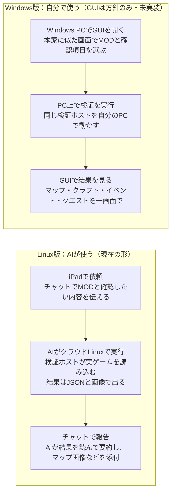

# RimWorld MOD検証ツールの完成形

2026-10-25 の構想を基に、2026-10-26 に既存の計画・コード・検証記録を照合して状態を更新しました。将来の UI/C/D の記述は実装済み機能と区別します。[未実施作業の棚卸し](../research/2026-10-26-planned-work-audit.md)を参照。

## 一言でいうと

完成すると、RimWorld を遊ばずに「この MOD を入れると、どの場面で何が壊れるか」を、本物のゲームのコードで確かめて結果を見せる検証専用の道具になります。遊べる状態にはなりません。

- 入力：検証したい MOD（フォルダか ZIP）と、確かめたいこと（例：この建物がマップに出るか、このレシピが作業台に出るか）。
- 出力：合否（passed / failed / incomplete / blocked）と、その理由、エラーの一覧、マップ画像や画面の再現。
- 「passed」は「指定した範囲で、本物の処理で問題が見つからなかった」という意味で、全場面の保証ではありません。確かめていない範囲は毎回結果に書かれます。

## 使い方の流れ

どちらも中身は同じ検証ホストで、違うのは依頼の出し方と結果の受け取り方だけです。いま動くのは上段の流れで、Linux の A/B とマップ生成は実ゲームの検証記録があります。下段のWindows GUIは方針として保存しただけで、まだ作っていません。

## 検証の段階

検証は下の段階を順に積み上げます。後ろの段階ほどゲームを先まで動かすので、分かることが増える代わりに時間がかかります。

| 段階 | ゲームをどこまで動かすか | 分かることの例 | 現状 |
| --- | --- | --- | --- |
| A 読み込み | 起動時のデータ読み込みまで | XML の誤り、パッチの失敗、翻訳の入れ先がない、Def の値 | 実装済み。Linux で公式と同じ結果を確認 |
| B DLL・Harmony | 同上（MOD のコードも実行される） | DLL が読めるか、期待した Harmony パッチが登録されたか | 実装済み。同上 |
| マップ生成 | 一時的なワールドとマップ 1 枚を作った直後 | MOD の建物が置かれるか、どこに置かれるか、生成中のエラー | Linux で実装・適格化済み（[記録](../research/map-qualification.md)） |
| C 指定動作 | 固定した有限ケースを実行（現在は新規 Bill） | クラフト画面で必要な材料が一覧に出るか・許可状態が正しいか、イベント/クエストの発生と選択肢を選んだ後の結果 | 材料候補の非描画ケースを実装（experimental）。イベント/クエストは未実装 |
| D 時間経過 | ゲーム内の時間を一定量進める（tick） | 数日動かして例外が出ないか、動作が正しく続くか | 未着手 |

C と D は「何を起こして、何が起きれば正しいか」を検証ごとに指定します。指定の例は最後の節にあります。プレイ中に起き得るすべての場面を自動で試すことはできないので、確かめる場面を選ぶ必要があります。

## Windows 版（あなたが使う GUI）の完成イメージ

Windows 版は、本家の画面に似せた検証専用のウィンドウで、指定から結果の確認までを 1 つの画面にまとめます。以下は私の提案で、まだ作っていません。

1. MOD の選択：本家の MOD 管理画面に似せた一覧。使う DLC、依存 MOD、読み込み順、検証対象の MOD を選ぶ。
2. 検証内容の指定：段階の選択。マップは本家のワールド生成画面に似せて、種・惑星の広さ・バイオーム・シナリオを選ぶ。
3. 実行中：本家の読み込み画面のような進捗表示。
4. 結果：合否と理由が先頭。その下にタブで、エラー一覧（本家の開発者用ログ風）、マップ（拡大・移動でき、MOD の物を強調）、クラフト画面の再現（作業台の指示タブ風）、イベント・クエストの記録（本家の通知・クエストタブ風）。

前提と決めていないこと：

- 本家のテクスチャやフォントは公開リポジトリに含められないので、あなたの PC のゲームフォルダからその場で読んで使う形になります。
- マップを本家と同じ見た目（本物の絵）で出せるかは未確認です。Windows なら GPU があるので、ゲームの描画を使える可能性があります。使えなければテクスチャをセルごとに並べる自前の描画になります。
- 画面は表示と指定だけで、コロニーを操作して遊ぶことはできません。
- 現在の検証本体は Linux でしか動きません。Windows で動かす作業も別に必要で、その後 Windows で公式と同じ結果になるかの確認も要ります。

## Linux 版（AI が使う）の出力

Linux 版に人向けの画面は作らず、AI が読んで判断しやすいファイルを出します。AI はそれを読んで、あなたには要約と画像をこのチャットで渡します。

| ファイル | 中身 | AI の使い方 |
| --- | --- | --- |
| result.json | 合否、理由のコード、段階ごとの状態、対象 MOD で新しく出たエラー、確認していない範囲 | 最初に読む。理由のコードで次に何をするか決める |
| events.jsonl | ゲームが出したログ 1 件ずつ（どの段階で出たか付き） | エラーの全文と発生場所を調べて MOD を直す |
| map.png / map-baseline.png | 対象込みと対象なしのマップの模式図 | 画像を見て配置を確かめ、あなたにも添付する |
| map-observation.json | 全セルの地形・屋根・物、物の位置一覧 | 「どこに何個あるか」を正確に数える |

C や D ができたら、同じ形でクラフト画面の中身（出たレシピの一覧）や、イベント・クエストの記録を足します。Windows 版の GUI もこの同じファイルを表示する形にすれば、両方で結果が食い違いません。

## 現在地

Linux の A/B とマップ生成は実装・適格化済みです。2026-10-26 には Codex Cloud で限定取得と全取得の A 比較も完了しています。PR #8/#9 の R2 統合は未マージで、ブランチ上の実績です。

| 項目 | 状態 | 次に必要なもの |
| --- | --- | --- |
| A・B（Linux） | 完成。main に統合済み。Harmony と VEF でも確認 | 実際に試したい MOD |
| マップ生成 | PR #6 はマージ済み。Linux で公式 quick test との分布比較による適格化の記録あり | 必要な MOD・種・期待値を指定して利用 |
| 公式実行ファイルの使用 | 適格化の開発用比較に限定。製品の検証フローからは起動しない | 通常起動・汎用ゲーム操作機能は追加しない |
| C（材料表示候補） | 非描画ケース実装、適格化と小麦粉 MOD 本体の検証は未完了 | 独立した参照動作との比較・実 MOD 入力の確認 |
| C（イベント・クエスト）、D（時間経過） | 方針を保存しただけ | 対象・初期状態・期待する結果を決める |
| Windows 版の検証と GUI | 方針を保存しただけ。現在 Windows での実行は blocked | Windows 版のゲームファイルと、あなたの PC での実行 |

## 指示の出し方と、決めてほしいこと

良い指示は「どの MOD を、どの構成で、どの場面で、何が起きれば正しいか」の 4 点がそろっています。そろっていない点は AI が既定値で埋めて、それを報告します。

例（今すぐできるもの）：

- 「この ZIP の MOD を Core と全 DLC、日本語で読み込んで、新しいエラーが出ないか確かめて。依存は Harmony と VEF」
- 「この MOD の Harmony パッチが全部登録されるか見て。失敗したら原因を直して再検証して」

例（Linux の対応環境で利用可能）：

- 「温帯林と乾燥低木地帯でマップを作って、この MOD の遺跡が 1 個以上出るか画像で見せて」

例（C ができたら、想定）：

- 「この作業台の指示画面を開いて、レシピ X が出るか、開いたときエラーが出ないか」
- 「襲撃イベントとこの MOD のクエストを発生させて、例外が出ないか、クエストのマップが生成されるか」

次に決めてほしいこと（急ぎません）：

- [x] C の最初の課題：小麦粉代替 MOD を例に、他 MOD でも材料表示の欠落を検出する。イベント/クエストは発生・選択後の動作も確認するというユーザー要求を記録（2026-10-26）。
- [x] 描画の境界：Linux は描画せず表示ロジックを検査し、Windows 版で実画面を描画する（ユーザー指定、2026-10-26）。
- [x] C の材料表示候補：設計承認後に固定ケースを実装（Linux 非描画・experimental）。
- [ ] C の適格化、ユーザーの小麦粉 MOD 本体での検証。
- [ ] Windows 版 GUI は、Linux での C より先に作るか、後にするか
- [ ] 最初に本物で試したい自分の MOD（あれば）
