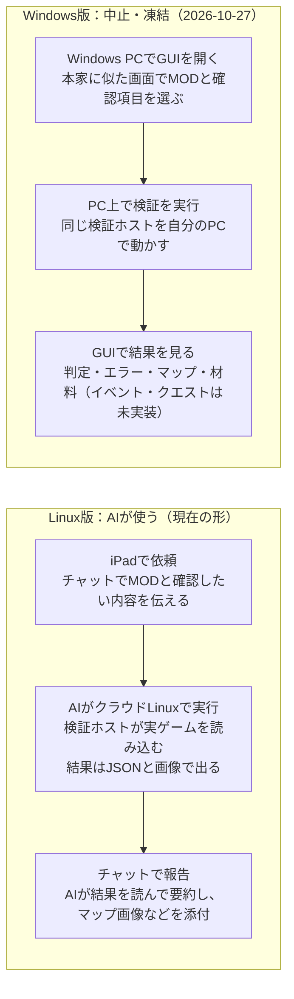

# RimWorld MOD検証ツールの完成形

2026-10-25 の構想を基に、2026-10-26 に既存の計画・コード・検証記録を照合して状態を更新しました。将来の UI/C/D の記述は実装済み機能と区別します。[未実施作業の棚卸し](../research/2026-10-26-planned-work-audit.md)を参照。

> **2026-10-27：Windows 版（W1 の Worker 実行・W2 の画面）の作業はユーザーの決定で中止・凍結しました。** 目標は AI がクラウドの Linux で使う検証ホストの完成です。Windows のコードには新しい機能を足さず、既存のテストと CI が通る状態だけを保ちます。W2 の実機確認は 1 回目のみ（起動・MOD 一覧の操作は動作、検証の完了は未確認）。

## 一言でいうと

完成すると、RimWorld を遊ばずに「この MOD を入れると、どの場面で何が壊れるか」を、本物のゲームのコードで確かめて結果を見せる検証専用の道具になります。遊べる状態にはなりません。

- 入力：検証したい MOD（フォルダか ZIP）と、確かめたいこと（例：この建物がマップに出るか、このレシピが作業台に出るか）。
- 出力：合否（passed / failed / incomplete / blocked）と、その理由、エラーの一覧、マップ画像や画面の再現。
- 「passed」は「指定した範囲で、本物の処理で問題が見つからなかった」という意味で、全場面の保証ではありません。確かめていない範囲は毎回結果に書かれます。

## 使い方の流れ

Linux が今後の開発対象で、Windows 版は中止・凍結しています。いま動くのは上段の流れで、Linux の A/B とマップ生成は実ゲームの検証記録があります。下段の Windows GUI（W2）は、ゲーム自身の描画と UI 部品で作り、クラウドの Linux で全タブの動作を確かめました。Windows の実機ではまだ動かしていません。

## 検証の段階

検証は下の段階を順に積み上げます。後ろの段階ほどゲームを先まで動かすので、分かることが増える代わりに時間がかかります。

| 段階 | ゲームをどこまで動かすか | 分かることの例 | 現状 |
| --- | --- | --- | --- |
| A 読み込み | 起動時のデータ読み込みまで | XML の誤り、パッチの失敗、翻訳の入れ先がない、Def の値 | 実装済み。Linux で公式と同じ結果を確認 |
| B DLL・Harmony | 同上（MOD のコードも実行される） | DLL が読めるか、期待した Harmony パッチが登録されたか | 実装済み。同上 |
| マップ生成 | 一時的なワールドとマップ 1 枚を作った直後 | MOD の建物が置かれるか、どこに置かれるか、生成中のエラー | Linux で実装・適格化済み（[記録](../research/map-qualification.md)） |
| C 指定動作 | 固定した有限ケースを実行（現在は新規 Bill） | クラフト画面で必要な材料が一覧に出るか・許可状態が正しいか、イベント/クエストの発生と選択肢を選んだ後の結果 | 材料候補の非描画ケースを実装（experimental）。イベント/クエストは未実装 |
| D 時間経過 | ゲーム内の時間を一定量進める（tick） | 数日動かして例外が出ないか、動作が正しく続くか | 未着手 |

C と D は「何を起こして、何が起きれば正しいか」を検証ごとに指定します。指定の例は最後の節にあります。プレイ中に起き得るすべての場面を自動で試すことはできないので、確かめる場面を選ぶ必要があります。

## Windows 版（中止・凍結：2026-10-27）

Windows 版は、本家の画面に似せた検証専用のウィンドウで、指定から結果の確認までを 1 つの画面にまとめます。W2 でゲーム自身の描画と UI 部品を使って作りました（使い方は [validation-host.md の 5 節](../validation-host.md)）。下の 1〜4 のうち、W2 で作ったのは MOD の選択（本家の MOD 管理画面に似せた一覧）、検証内容（段階・言語・マップの種とバイオーム・C・追加の期待値）、実行中の進捗と中止、結果（判定と理由、エラー一覧、マップ 2 枚の並列、製造指示の材料、確認範囲）と履歴です。惑星の広さ・シナリオの選択、マップの拡大と MOD の物の強調、作業台の画面の再現、イベント・クエストはまだです。

1. MOD の選択：本家の MOD 管理画面に似せた一覧。使う DLC、依存 MOD、読み込み順、検証対象の MOD を選ぶ。
2. 検証内容の指定：段階の選択。マップは本家のワールド生成画面に似せて、種・惑星の広さ・バイオーム・シナリオを選ぶ。
3. 実行中：本家の読み込み画面のような進捗表示。
4. 結果：合否と理由が先頭。その下にタブで、エラー一覧（本家の開発者用ログ風）、マップ（拡大・移動でき、MOD の物を強調）、クラフト画面の再現（作業台の指示タブ風）、イベント・クエストの記録（本家の通知・クエストタブ風）。

前提と決めていないこと：

- 本家のテクスチャやフォントは公開リポジトリに含められないので、画面プログラムはあなたの PC のゲームの DLL を参照してビルドし、素材はゲームフォルダからその場で読みます。
- マップを本家と同じ見た目（本物の絵）で出すのは 中止・凍結した W3 の課題でした。W2 の結果タブは検証が書いた画像（`map.png`）を表示します。
- 画面は表示と指定だけで、コロニーを操作して遊ぶことはできません。
- 検証本体は Windows x64 でも動くようになりました（W1、描画なし、公開 CI はゲームなしの偽 Worker で確認）。Windows 実ゲームの fixture 確認は行いましたが、公式比較による適格化は未実施で、以後の作業は中止・凍結です。

## Linux 版（AI が使う）の出力

Linux 版に人向けの画面は作らず、AI が読んで判断しやすいファイルを出します。AI はそれを読んで、あなたには要約と画像をこのチャットで渡します。

| ファイル | 中身 | AI の使い方 |
| --- | --- | --- |
| result.json | 合否、理由のコード、段階ごとの状態、対象 MOD で新しく出たエラー、確認していない範囲 | 最初に読む。理由のコードで次に何をするか決める |
| events.jsonl | ゲームが出したログ 1 件ずつ（どの段階で出たか付き） | エラーの全文と発生場所を調べて MOD を直す |
| map.png / map-baseline.png | 対象込みと対象なしのマップの模式図 | 画像を見て配置を確かめ、あなたにも添付する |
| map-observation.json | 全セルの地形・屋根・物、物の位置一覧 | 「どこに何個あるか」を正確に数える |

C や D ができたら、同じ形でクラフト画面の中身（出たレシピの一覧）や、イベント・クエストの記録を足します。Windows GUI への新規機能追加は行いません。

## 現在地

Linux の A/B とマップ生成は実装・適格化済みです。2026-10-26 には Codex Cloud で限定取得と全取得の A 比較も完了し、R2 統合（PR #8/#9）はマージ済みです。

| 項目 | 状態 | 次に必要なもの |
| --- | --- | --- |
| A・B（Linux） | 完成。main に統合済み。Harmony と VEF でも確認 | 実際に試したい MOD |
| マップ生成 | PR #6 はマージ済み。Linux で公式 quick test との分布比較による適格化の記録あり | 必要な MOD・種・期待値を指定して利用 |
| 公式実行ファイルの使用 | 適格化の開発用比較に限定。製品の検証フローからは起動しない | 通常起動・汎用ゲーム操作機能は追加しない |
| C（材料表示候補） | 非描画ケース実装。小麦粉 MOD 本体で不具合版の検出と修正版の非検出を観測（[記録](../research/2026-10-26-flour-mod-c-run.md)）。適格化は未完了 | 非描画での独立した比較方法を設計し適格化 |
| C（イベント・クエスト）、D（時間経過） | 方針を保存しただけ | 対象・初期状態・期待する結果を決める |
| Windows 版の検証（W1） | 実装済み（描画なし、`experimental`）。あなたの PC の実ゲームで fixture 22 件・C 6 件が Linux と同じ判定（[記録](../research/2026-10-26-windows-w1-real-game.md)） | 中止・凍結（2026-10-27） |
| Windows 版の GUI（W2） | 作成済み（PR #11）。クラウドの Linux で全タブ・実行・中止を確認。Windows 実機は未確認 | 中止・凍結（2026-10-27） |
| Windows 版の描画（W3） | 方針のみ | 中止・凍結（2026-10-27） |

## 指示の出し方と、決めてほしいこと

良い指示は「どの MOD を、どの構成で、どの場面で、何が起きれば正しいか」の 4 点がそろっています。そろっていない点は AI が既定値で埋めて、それを報告します。

例（今すぐできるもの）：

- 「この ZIP の MOD を Core と全 DLC、日本語で読み込んで、新しいエラーが出ないか確かめて。依存は Harmony と VEF」
- 「この MOD の Harmony パッチが全部登録されるか見て。失敗したら原因を直して再検証して」

例（Linux の対応環境で利用可能）：

- 「温帯林と乾燥低木地帯でマップを作って、この MOD の遺跡が 1 個以上出るか画像で見せて」

例（C ができたら、想定）：

- 「この作業台の指示画面を開いて、レシピ X が出るか、開いたときエラーが出ないか」
- 「襲撃イベントとこの MOD のクエストを発生させて、例外が出ないか、クエストのマップが生成されるか」

次に決めてほしいこと（急ぎません）：

- [x] C の最初の課題：小麦粉代替 MOD を例に、他 MOD でも材料表示の欠落を検出する。イベント/クエストは発生・選択後の動作も確認するというユーザー要求を記録（2026-10-26）。
- [x] 描画の境界：Linux は描画せず表示ロジックを検査する。Windows の描画計画は中止・凍結（2026-10-27）。
- [x] C の材料表示候補：設計承認後に固定ケースを実装（Linux 非描画・experimental）。
- [ ] C の適格化、ユーザーの小麦粉 MOD 本体での検証。
- [x] Windows 版 GUI：W1 の後に W2 を作る。方式は「ゲームの描画で作る」（ユーザー選択、2026-10-26）。
- [ ] 最初に本物で試したい自分の MOD（あれば）
