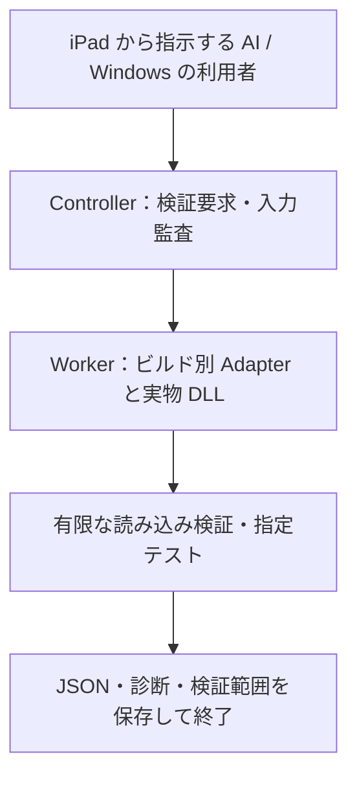

# RimWorld MOD 検証専用ホスト：仕様・設計案

日付：2026-10-25（日本時間）。状態：**Linux x86_64 で主案の成立を確認し、A/B を実装済み（2026-10-25 更新）**。実装と結果は [製品計画](../plans/test-only-host-product.md)、[呼出し経路](../../research/test-host-entrypoints.md)、[適格化](../../research/test-host-qualification.md)、[性能](../../research/test-host-performance.md)、[契約](../../contracts/mod-validation-v1.md) を参照。以下の本文は設計時点の記述で、§3 と §11 の「現状」は更新前の状態を指す。Windows 実行・D は未実装。2026-10-26 に C の新規 Bill 材料候補ケースを追加（非描画・experimental、[契約](../../contracts/mod-validation-v1.md#c製造指示の材料候補非描画experimental)）。

## 1. 原点と文書の優先順位

ユーザーが最初に伝えた目的：

> RimworldのMODを作成するとき、rimworldが開けない環境にあっても実ゲーム検証を行えるようなものを作りたい。ゲームとして遊べる形には決してせず、あくまでテスト用の用途のみにとどめる。

追加された目的は、ゲームを開ける Windows 環境でも、通常起動より早く必要な検証を済ませ、問題を直してから別途ゲームを開いて遊べること。速くなることは目標であり、現在確認済みの事実ではない。

**優先順位は、ユーザーが PC を使わずに iPad から AI へ依頼し、AI が Linux 上で実物のゲーム処理を使って検証・修正・再検証を進めることが第一、Windows でユーザー自身が速く検証することが第二。** Windows PC への遠隔接続で第一の用途を置き換えない。検証対象の正規ファイルを一度提供・準備した後は、通常の検証サイクルでユーザーの PC 操作、PC の起動継続、手動のゲーム内確認を必須工程にしない。

本書は、[旧 headless 設計](2026-10-25-headless-validation-design.md)、[旧二用途設計](2026-10-25-dual-use-design.md) の製品方式・通常起動・対象環境に関する記述に優先する。旧資料の「合意済み」は当時の引き継ぎ情報であり、最新のユーザー意図を上書きしない。[入力監査](2026-10-25-offline-input-audit-design.md) は補助工程として維持する。

ユーザーが指定したのは目的、二つの用途、プレイ不可、今回は実装しないこと。以下のホスト方式、段階、上限、名前、測定方法は**設計側の提案**であり、技術的に成立・承認済みとは扱わない。

## 2. 要求と禁止する機能

| ID | 要求 | 受け入れ条件 |
|---|---|---|
| R1 | PC を使わず AI に検証・修正を任せる | iPad は依頼・ファイル提供・報告確認に使う。Linux x86_64 上の CLI を AI が画面なしで使い、検証・許可範囲の MOD 修正・再検証・成果物作成まで進める。ユーザーの Windows PC の起動・遠隔実行・手動テストを必須にしない |
| R2 | Windows でも同じ検証を使う | Windows x64 の CLI と検証用画面が同じ要求・判定仕様を使う。Windows 利用者に WSL を要求しない |
| R3 | 実物の処理に基づく検証 | 対応ビルドのゲーム DLL・Data を私有領域から読み、可能な範囲で本物のロード・型解決・参照解決・MOD 初期化・Harmony を実行する。独自 XML チェックだけを実動作検証と呼ばない |
| R4 | 検証専用 | 製品は公式ゲームの実行ファイルを起動しない。メインメニュー、対話的なコロニー操作、任意のセーブによる継続プレイ、無期限 tick、ゲームへの接続・引き継ぎ、通常起動ボタンを提供しない |
| R5 | 待ち時間を減らす | 必要な検査を指定し、不要な描画・対話 UI を初期化しない。省略した検査は明記する。同じ範囲での高速化は別途測る |
| R6 | 失敗と未検証を区別する | 成功は依頼範囲と環境の証拠が揃った場合のみ。環境不足・観測不足・非対応を MOD の不具合や成功へ変換しない |
| R7 | 原本と成果物の分離 | 原本・通常の設定・セーブを変更しない。ゲームファイル・ユーザー情報を公開リポジトリ、公開 CI、配布物へ含めない |

「プレイ不可」はツールが提供する機能と正常な実行経路の制約。任意の MOD コードが動くため、悪意あるコードを GUI の非表示だけで封じると約束しない。ソース改造を絶対に不可能にする DRM も目的ではない。

ユーザーの「ゲームを開けない環境」は、GUI を使えない Linux でも必要な検証用ファイル・対応ランタイム・計算資源を利用できる状況を主対象とする。ゲームの処理やリソースを全く持たずに互換性を証明するものではない。

### PC を使わない主用途の完了条件

ユーザーが iPad から検証対象・修正依頼を渡し、AI が Linux 上で検証要求を作成し、検証専用ツールの診断を使って許可された MOD のソース/設定を直し、再検証する。ツールそのものが自動修正する機能は要求しない。修正判断と編集は AI の作業であり、ゲームの公式ファイルを改変してテストを通すものではない。

成果物は、導入できる形の修正 MOD（必要ならビルド出力）と、対象ビルド・MOD 構成・検証範囲・確認した動作・残る未確認事項を記した報告。「遊べる状態にする」はこの MOD を準備する目的であり、ツール内でプレイさせたり、ユーザーが実際に起動するまで AI の作業完了を保留したりする要件ではない。

完了報告では、依頼されたケースで確定した不具合が解消され、対応する検証が通った範囲を示す。未実行の長時間プレイや Windows 固有挙動を全て保証する表現はしない。Linux で検証できない重要な範囲が残るなら、それを隠さず未完了/未確認として示す。手動テストを必須にしないことを理由に、結果の合格条件を緩めない。

受け入れ時には「ユーザーの PC が停止・未接続」という条件で、iPad からの依頼、Linux の検証、AI の修正、再検証、MOD と報告の受け渡しまで成立するかを確認する。Windows 版の機能や Remote の設定がないためにこのフローが止まる設計は不適合。

## 3. 現状と根拠

既存の `tools/audit_inputs.py` と `tools/mod_preflight.py check` は入力監査・静的事前検査のみ。DLL はハッシュし、ロードしない。結果の `gameVerification=notRun` は正しいまま維持する。CLI `play`、GUI の起動ボタンは旧方針の実装として存在するが、本仕様には不適合。今回はコードを変更せず、移行計画で削除対象にする。

直接確認済み：受領 DLL の runtime target は win-x64、TFM は net10.0、runtime pack は `10.0.13-waylithclr.dev`。WaylithClr の assembly redirect、binding、JIT patchable assembly、Mono 互換 hash 等の設定がある。遅延した static constructor と翻訳注入、MOD 自動回復、実有効 MOD の照合、ログキュー上限に注意が必要。[静的調査](../../../notes/2026-10-25-source-audit.md) を根拠にする。**設定の存在から、独自ホストでも同じ動作になるとは断定しない。**

Windows 用 DLL があることは Linux で実行できる証明ではない。一方、Linux 公式実行ファイルの不足を理由に全ての設計・調査を止める必要もない。必要な managed/native 依存とランタイムは実行する工程ごとに調べる。

以前の標準 .NET 試運転は [引き継ぎ報告](../../../notes/headless-spike-report.md) のみで、コードは現リポジトリに存在せず、今回再現していない。Steam 確認を飛ばす、音声を差し替える等の以前の措置を、本ホストの正しさの証拠や採用済み方針にしない。

## 4. 方式比較と主案

| 方式 | 適合する点 | 問題と扱い |
|---|---|---|
| ゲーム DLL の処理を呼ぶ独立した検証ホスト | 実物の処理を使い、呼ぶ工程と終了点を制御できる。二用途と検証専用を両立する方向 | 起動順序・static 状態・CLR・native 依存との同等性を立証する必要。**主案として調査し、成立条件を満たすまで製品化しない** |
| ローダー・ゲーム挙動を独自再実装するシミュレーター | OS 依存を小さくできる可能性 | 再実装とゲームがずれ、MOD の広い互換性を保証できない。静的補助検査に限り採用し、主検証にはしない |
| 公式ゲーム実行ファイルの headless 起動を包む | 本来の起動との比較基準にできる可能性 | ユーザー指定の独立した検証ツールの製品方式と異なる。**製品の自動フォールバックにはしない**。開発時の別の比較実験としてのみ扱う |

主案の不成立が判明したら、理由・不可能な範囲・代替案を提示し、仕様変更を別途判断する。途中で公式起動方式へすり替えない。「独立ホスト」という名称だけでゲーム本来の全経路との一致を主張しない。

## 5. 構成と実行の境界

### Controller、Worker、ビルド別 Adapter

Controller は要求検査、私有作業領域、入力識別、別プロセス監視、結果照合を担う。既存 Python 3.12+ CLI と Windows 画面を土台にする案。ただし静的検査の既存 JSON は別契約のまま残す。

Worker は自作の検証専用 C# ホスト。受領ビルドが net10.0 のため .NET 10 を初期候補とするが、**標準 CLR で十分という決定ではない**。Worker が選択した CLR 上でゲーム DLL と対象 MOD をロードする。Controller の CLR や Python プロセスへ DLL を読み込まない。Worker はテスト要求の有限な工程だけを実行し終了する。

Adapter はゲームビルド・実行 OS・CLR の組に固定したロード順序、パス、assembly 解決、完了観測、診断、Harmony 観測を実装する。対応外ビルドは既知の Adapter で推測実行しない。ゲーム DLL の本文をコピー・再配布せず、ユーザー所有の実物を参照する。

Controller と Worker はファイルを介した版付き要求・イベント・結果を使う。公開 HTTP サーバー、ゲーム操作 RPC、対話コンソールは設けない。拡張テストコードはコード入力として扱い、専用のテスト interface だけを呼ぶ。任意のメソッド名を CLI から指定してゲーム全体を操作する汎用機能にしない。

### 初期化順序と除外

実物の A/B ロード処理、MOD の constructor、遅延処理、公式エラー検査を順序付きで実行する。ロード API の戻りだけでは完了にせず、遅延イベント、翻訳後半、static constructor、最終有効 MOD 順序と回復発生を確認する。必要な工程の正確な API と停止点は、後の成立性調査の成果物とする。

描画・音声・Steam 等を含む依存は、必要性を実測して工程ごとに分ける。テスト範囲外のサービスを起動しないことと、必要な呼び出しを常に成功する stub に差し替えることは別。使用した差し替え・未提供サービスは必ず記録し、それに依存する検査を `blocked` または `incomplete` にする。権限・所有確認を迂回する変更を行わない。`-NoAssetPack` 等の欠損無視で資材検査を通過させない。

## 6. 検証レベルと到達目標

| レベル | 対象 | 完了証拠と制限 |
|---|---|---|
| S：静的 | 既存の入力監査、About、構成、依存、順序、XML 構文 | ゲームコード未実行。以降の合格の代用にしない |
| A：実ローダー | 対象と依存の XML パッチ、継承、型変換、Defs、参照解決、選択言語の注入、公式エラー検査 | 実処理の各工程完了、実有効 MOD 順序、期待 Def/assertion、診断を照合。未選択言語と実行時の振る舞いは未検証 |
| B：DLL・Harmony | DLL 解決、MOD 初期化、起動時 static constructor、Harmony の登録と期待対象・種別・owner の一致 | 実ロード assembly の hash と期待パッチの完全指定を照合。登録だけで効果・transpiler の意味的正しさを証明しない |
| C：指定動作 | 自作の有限なテストがメソッド呼び出し・状態変更・期待結果を検証 | C は後段。ケース ID、前提、期待値、呼んだ処理と結果を記録。対象ケース外の機能は未検証 |
| D：ゲーム世界を要する指定動作 | 将来、テスト用の一時マップ・限定 tick が必要なケース | 別の詳細設計と実装判断が必要。初期実装計画には含めない。採用しても対話・無期限実行・継続セーブは禁止 |

S/A/B を最初の成立性目標とし、A/B ができた時点を「全 MOD の動作確認が完成」としない。C を扱えるテスト契約と結果項目は先に定義するが、初回ロード検証と同時に広範なゲームシミュレーションを作らない。

C のテストは、実際にその MOD のパッチが適用された元メソッドを呼び、期待する結果を assert する。パッチメソッドだけを単独実行した結果は補助単体テストとして区別する。UI の描画、GPU、音声出力、OS 固有ライブラリが必要なものは、対応したテストを別途実装するまで範囲外。スクリーンショットを出すだけで合格とはしない。

### プレイ不可を保つ実行条件

製品の引数・画面・配布物には通常起動、ゲーム executable の任意指定、`play`、対話入力、自由なシーン遷移を設けない。Worker の stdin は閉じ、ゲームの対話 UI を生成しない。OS に対する設定用 GUI は許容するが、ゲーム画面の操作用にはしない。

C は明示した test ID と上限が必須。将来 D を追加する場合もテスト fixture から新規の一時世界を作り、tick 上限・時間上限を両方適用して必ず廃棄する。通常の個人セーブを入力する機能は当面設けない。GUI 表示要求や対話ループへの進入が検出された場合は強制終了し、`incomplete` を返す。検出器の完全性は後で検証する事項であり、今は保証しない。

## 7. OS・ランタイム・互換性の意味

対応単位は単なる「1.7」ではなく、ゲーム DLL/Data の識別、OS/architecture、実 CLR と設定、Adapter、Harmony、MOD の hash の組。Windows x64 と Linux x86_64 は別に成立性を確認する。初期対応は受領済みの 1.7 Waylith ビルドを固定対象とし、将来のゲーム更新を自動で対応済みにしない。Anomaly は今回の対象外。

| 実行 | 言えること | 言えないこと |
|---|---|---|
| Linux ホストで Windows 由来の managed DLL を調査・実行 | 成立した工程とその環境での結果。成立前は静的調査のみ | Windows 固有 DLL、UI、ネイティブ連携まで動くこと |
| 対応済み Linux の CLR/Adapter で A/B が完了 | その Linux 構成での A/B の合格 | 同じ MOD が Windows でも必ず動くこと |
| Windows の対応 CLR/Adapter で A/B または C が完了 | その Windows 構成と対象ケースの結果 | 長時間プレイや未実行ケースの問題がないこと |

標準 .NET の Worker は探索用候補。WaylithClr の assembly redirect、緩い binding、JIT/inlining、hash 等が対象 MOD に与える差を調べ、同等性の証拠がない組は `fidelity=experimental` とする。実行できてもゲーム互換性の合格は出さない。差が対象に無関係と証明できた限定範囲だけを、根拠付きで `qualified` にできる。未知の差を包括的に無視しない。

WaylithClr を使う案も独立ホストで正常に初期化できるか未確認。OS 対応ランタイム、native 依存、同一ビルドのデータが必要になる可能性がある。Linux 版の全ゲーム実行ファイルを製品が起動する前提は撤回するが、**Linux のランタイム等が一切不要という結論にはしない**。不足は必要な工程の `blocked` として報告する。

### 比較による適格化

後の開発で独立ホストの結果を信頼できる範囲へ広げるため、正常と故障を混ぜた自作 fixture を、対応する本物のゲーム環境で別途実行した結果と比較する。XML パッチ後の期待値、参照解決、翻訳、初期化順序、Harmony の登録先、代表的な呼び出し結果を比較し、Def 件数や終了コードの一致だけで適格化しない。

比較は開発時に行う別作業で、製品の検証要求からゲームを自動起動しない。PC を使えない通常利用者に毎回比較実行を要求しない。比較環境を得られない期間は探索結果・未適格の範囲を報告し、Windows 対応や `qualified` を先取りしない。適格化の有効範囲と証拠 ID を OS/ビルド/工程ごとに保存し、ゲーム・CLR・Adapter 更新で失効させる。

### 利用端末、開発環境、Windows 実行の経路

2026-10-25 に確認。利用者の iPad は指示・結果確認の端末であり、AI がコマンドを実行する OS を決めるものではない。モデルの変更だけで Windows 実行環境が用意されるとは扱わない。この会話の shell は Linux x86_64 で、Windows デスクトップ/実行ホストは接続されていない。これは本セッションの確認結果で、ChatGPT 全体の Windows 非対応を意味しない。

| 経路 | Windows 対応への用途 | 現在の可否と境界 |
|---|---|---|
| このセッションの Linux | 共通コード、Windows 向けソースの作成、静的調査 | 利用可能。Windows の native/画面動作を実測したことにはならない |
| GitHub Actions の Windows runner | 自作コードのビルド、単体/契約/監視テスト、対応範囲の画面生成 | 既存 workflow に windows-latest があり、[run 40177669007](https://github.com/pengin0503/RimWorld-for-mod-test/actions/runs/40177669007) の Windows Python 3.12/3.13 が成功。現在は自作 fixture のテストのみで、ゲーム DLL の動的検証ではない |
| 利用者自身の Windows 環境 | 利用者が Windows 版ツールで検証する追加用途。開発時には私有資材での Windows 適格化にも使える | Linux 上の AI に任せる主用途とは独立。ユーザーの PC が利用不能でも Linux の検証を継続できることが必要 |

以前調べた Windows ホストへのモバイル接続機能は、本プロジェクトの製品方式・主用途・必須依存には採用しない。利用者の PC が必要な遠隔実行方式へ主用途を変えない。Windows 向けソース作成とゲーム不要 CI は開発手段として使い、実物 Windows 検証は別の私有環境で行う。公開 CI に添付のゲーム DLL/Data や個人情報を渡さない。

### Linux 版を受領した後の着手条件

Linux の同一更新時点のランタイム/managed/native 一式があれば、依存・ビルド・資材の確認と最小ホストの成立性試験へ進むための材料が増える。受領だけで必要条件を全て満たしたとはせず、Core 資材・Harmony・実際の CLR 初期化・必要な呼出し順を工程別に確認する。コードを書くこと自体に Linux の全公式実行ファイルが必須なのではなく、実際の動作と同等性を判定するための入力が必要なのである。

共通の要求/結果・監視や Windows 用ソースは Linux 版の入手と独立に準備可能。本格的なローダー/Adapter の詳細は、正確な API と実行経路の調査後に決める。現在は「実装しない」という依頼が継続しており、ファイル受領や本項の追記だけで試作・製品実装を開始しない。

## 8. 入力、独立した作業領域、監視

要求はゲーム資材の root、順序付き active packageId、MOD の root と依存、対象言語、要求レベル、期待 Def・Harmony、C の test ID、上限を含む。通常の `ModsConfig.xml` は選択を取り込む補助入力に限り、新規の検証用設定を作る。渡されたユーザープロファイル全体や個人セーブを実行へ流用しない。入力 ZIP の展開は既存監査とは別の準備工程であり、初期ホストは展開済みの入力を使う。

実行対象と依存は私有領域へ実体コピーし、hash と元の位置を記録する。実行コードが原本を書き換えられる hardlink は使わない。通常の設定、セーブ、キャッシュと共有しない。Worker の全書き込み先は run 領域に固定する。これらはパス設計であり、任意コードに対する完全な OS sandbox の証明ではない。

各言語・実行環境・独立ケースは新しい Worker とする。未検証の assembly unload や static 状態の再利用を速度のために導入しない。最終有効 MOD と順序を要求と照合し、自動回復・DLC 追加・自動ソートで変わった実行は合格にしない。

設計初期値は Worker 起動後 180 秒、子孫を含むメモリ 4,096 MiB、観測ログ計 32 MiB、構造化診断 2,000 件・各本文/stack 16 KiB。初期値で不足する正常ケースは明示的に設定を増やす。上限まで処理したことを成功にしない。C の各ケース上限は test 定義に固定し、run 全体の上限を超えられない。

Linux の process group/cgroup、Windows の Job Object 等の利用可否と実際の停止範囲を記録する。厳密なメモリ制約や隔離を要求したのに利用できない場合は開始前 `blocked`。単なる監視ポーリングを hard limit と呼ばない。子孫回収・timeout・ログ過多・中断時にも部分結果を残し、観測が揃わない限り `incomplete` とする。

## 9. 要求・結果契約（将来仕様）

既存 `modPreflight` schema 1 は変更しない。将来契約は `recordType=modValidationRequest` / `modValidationResult`、`schemaVersion=1` とし、既存結果を読み替えて合格にしない。具体的な JSON Schema と実装は後の計画に分離する。

結果の必須情報：

- runId、使い捨て nonce、要求 hash、入力 fingerprint、ツール/Adapter の版、開始/終了。
- 実 OS/architecture、実 CLR/設定、ゲーム DLL/Data・依存 MOD・Harmony の hash、要求/実ロードの順序付き MOD リスト、言語。
- `status`、`executionStatus`、`fidelity`、工程別結果、要求/実行/省略の範囲、根拠 ID、差し替え、未対応依存。
- assertion ごとの期待値と実値、診断の出所・段階・確定/推定、遅延処理の完了証拠、ログ欠落・打切り数。
- 準備・hash・起動・各検査・終了回収の秒数、全体の実時間、メモリの計測方式と上限。

`executionStatus` は `completed`、`failed`、`notStarted`、`interrupted`。`fidelity` は `qualified` / `experimental`。全体 `status` は次の意味に固定する。

| status | 条件 |
|---|---|
| passed | 要求した全工程が完了・期待値一致・判定対象の問題なしで、**全要求範囲が対応環境で qualified**。限定範囲の合格であり万能保証ではない |
| failed | qualified な範囲で、対象の確定エラーまたは assertion 不一致を確認し、要求全体の観測も完了した |
| blocked | 必須資材・対応 OS/CLR/Adapter・前提設定がなく、要求した検証を開始できない。空の要求もこれに該当 |
| incomplete | 実行後の観測欠落、timeout、crash、結果欠損、上限、要求の一部非対応、または experimental のためゲーム互換性を結論できない |

起動前 blocked → 起動後に不足/未適格があれば incomplete → 全体観測が揃えば failed/passed の順で判定する。`incomplete` でも確認できたエラーは消さず個別診断として残す。experimental で assertion が通っても `executionStatus=completed, status=incomplete`。確定した qualified な部分失敗がある場合も部分結果に残す。

工程ごとに `notRequested` を認める。B を依頼したのに期待パッチ指定がない場合は不完全とし、単なる全件列挙を合格にしない。パッチ指定は assembly/type/method/引数型/generic arity、owner、種別、パッチメソッドを含む。A と B の依存関係は Adapter に定義し、必要な A を省いて B のみ合格にしない。

警告を握りつぶさない。初版は未知の警告を合格の障害とし、既知の無害なものだけをビルド・範囲・根拠付き規則で区別する。環境/対象への責任は証拠がある場合のみ割り当てる。JSON のパスや生ログには私有情報があり得るため、公開用には別途集計する。

結果は親が runId/nonce/hash を照合し、途中ファイルではなく atomic な最終結果と終了時のイベントを合わせて確定する。stale 結果、終了コード 0、何も検査しなかった空配列、単一の完了 callback では成功にしない。終了コード案は `0=passed, 1=failed, 2=blocked, 3=incomplete`。既存 preflight の終了コードとは別契約。

## 10. 速度の設計と測定

Windows 追加の動機は、実際に問題を直すまでの待ち時間短縮。初回の素材準備を無視した Worker 単体秒数だけを宣伝しない。

- 同一 PC・ゲームビルド・MOD 順序・言語・必要検査で、通常起動が比較可能なロード地点に到達するまでと、ツールが診断を確定するまでを測る。通常起動側で走らない追加エラー検査があればその差も記録する。
- 初回準備込みの全体、再実行、Worker のみを分け、cold/warm 条件と測定回数を記録。原則各条件 5 回の中央値と範囲を掲載し、OS のファイルキャッシュを消せない環境は cold を名乗らない。
- S だけの高速結果、A/B、C の結果を別に載せ、範囲の狭い検査をゲーム同等の高速化倍率として示さない。ユーザー環境で速くない場合はそのまま報告する。
- 最初は private snapshot の hash 照合と不要 UI/描画の非初期化を優先する。任意 MOD の影響が広いため、変更ファイルだけのゲーム処理再実行や共有 Worker は初期版に入れない。
- 将来キャッシュを入れる場合はゲーム/CLR/Adapter、全有効 MOD と順序、言語、設定、テスト、資材 coverage を key に含め、欠落・更新で再検証する。過去結果の提示を今回実行した結果と混ぜない。

速度達成値は実測後に決定する。現在の Core XML 構文検査約 0.21 秒は A/B の実行時間でも、通常起動との比較でもない。

## 11. 既存実装からの移行と提供物

今回は文書だけを更新する。`play`、起動ボタン、実行ファイル必須チェックは現コードに残っており、新仕様への対応済みとは表示しない。

将来の移行順：通常起動の CLI/画面経路を廃止し、静的検査を検証専用の入口として整理する。静的検査に不要な公式 executable 必須条件は外す。既存プロフィールは読み取りで移行し、動的検証には新しい要求を用いる。通常のユーザー設定を検証要求で上書きしない。CLI の `play` 呼出しには移行エラーを出し、製品から起動しないテストを置く。

完成時の配布物は Controller、検証用 Worker/Adapter、ゲームを含まない自作テスト、文書。ゲーム DLL、Data、WaylithClr、Harmony の実物は初版では私有入力として扱い、公開配布へ含めない。再配布条件の調査は必要な依存を決めた後に行う。公開 CI は自作 fixture と契約・監視・画面の検査に限定する。私有ゲーム検証の結果と CI 成功を区別する。

## 12. 成立性調査、到達判定、未決事項

次に進む際は [段階計画](../plans/2026-10-25-test-only-host.md) に従う。最初に成立性調査を実施し、以下の証拠が得られるまでは大きな製品実装へ進まない。

1. Windows 由来 managed DLL の OS/CLR 依存図と、Linux/Windows 各 Worker の最小呼出し・終了点。
2. A/B に必要な初期化順序と遅延処理、ゲームの対話 UI に入らず終了できる経路。
3. 各工程で必要な資材と native 依存。欠損を偽成功で埋めていない記録。
4. 対応 CLR と違い、同等性の証拠または未適格の理由。Harmony を適格化するのに必要な実行環境。
5. 正常系と既知故障 fixture の比較計画、および独立ホストが本来の失敗を検出できること。

本書は実行 API、Linux WaylithClr の入手・初期化、最小素材集合、速度優位を未確認のまま「できる」としない。これらはユーザーに推測で答えてもらう事項ではなく、実装を許可された後の調査項目。成立しない段階は証拠付きで止め、別方式へ黙って変更しない。
